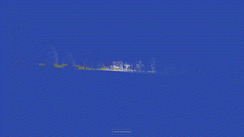
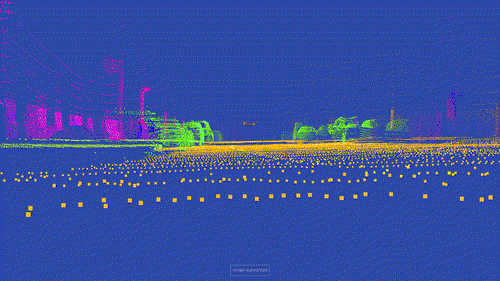
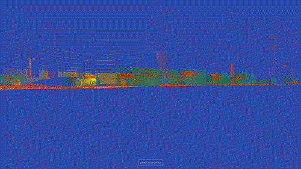

# ImmersivePoints

**Explore point clouds in 3D, including in VR and in Python**

ImmersivePoints is a Python package and web application that lets you visualize 3D point clouds in VR and Jupyter notebooks. Whether you're working with LiDAR data, 3D scans, ML embeddings, or any spatial data, ImmersivePoints makes it easy to see your data in an immersive, natural way.

[](https://opensource.org/licenses/MIT)
[](https://www.python.org/downloads/)

---

## Features

- **🎮 VR Visualization**: View point clouds in virtual reality (Oculus Quest, PC VR headsets)
- **📊 Jupyter Integration**: Render point clouds inline in notebooks with a single function call
- **🎨 Flexible Formats**: Support for XYZ, XYZI (with hue coloring), and XYZRGB point clouds
- **🗜️ Cloudini Compression**: Load [Cloudini](https://github.com/facontidavide/cloudini) compressed `.cldn` files directly, and convert to and from Cloudini in the browser
- **⚡ Fast**: Efficient binary format and Three.js renderer for smooth performance

---

## Gallery

<table>
  <tr>
    <td align="center">
      <br/>
      <b>Astyx LiDAR + Radar</b><br/>
      Automotive sensor fusion data
    </td>
    <td align="center">
      <br/>
      <b>PandaSet RGB</b><br/>
      Full-color urban scene
    </td>
    <td align="center">
      <br/>
      <b>Semantic Segmentation</b><br/>
      Labeled autonomous driving data
    </td>
  </tr>
</table>

[**→ View more examples on immersivepoints.meertens.dev**](https://immersivepoints.meertens.dev/)

## Examples

The [`examples/`](examples/) directory contains comprehensive tutorials:

### 📚 Tutorial Notebooks
- **[`inline_visualization.ipynb`](examples/inline_visualization.ipynb)** - Complete guide to Jupyter rendering
- **[`export_subsample.ipynb`](examples/export_subsample.ipynb)** - Subsample large point clouds
- **[`export_csv.ipynb`](examples/export_csv.ipynb)** - Load and export CSV data
- **[`export_ply.ipynb`](examples/export_ply.ipynb)** - Work with PLY 3D scan files
- **[`export_embeddings.ipynb`](examples/export_embeddings.ipynb)** - Visualize neural network embeddings

### 🚗 Autonomous Driving Examples
- **[`export_AEV_data.ipynb`](examples/export_AEV_data.ipynb)** - AEV self-driving car dataset
- **[`Astyx dataset lidar and radar.ipynb`](examples/Astyx%20dataset%20lidar%20and%20radar.ipynb)** - Sensor fusion visualization
- **[`Export PandaSet.ipynb`](examples/Export%20PandaSet.ipynb)** - PandaSet with semantic labels

---

## Supported Data Formats

ImmersivePoints supports three point cloud formats:

| Format | Columns | Description |
|--------|---------|-------------|
| **XYZ** | 3 | `[x, y, z]` - Positions only (auto-colored) |
| **XYZI** | 4 | `[x, y, z, hue]` - Positions + hue (0.0-1.0) |
| **XYZRGB** | 6 | `[x, y, z, r, g, b]` - Positions + RGB (0.0-1.0) |

All coordinates should be `float32` numpy arrays.

### Coordinate system

Positions use a right-handed frame with **X forward, Y left and Z up**, the ROS convention (REP 103) used by most lidar datasets, so sensor data needs no conversion. Boxes, lines and objects use the same axes; a box's heading is its rotation around Z. The viewer converts this to three.js axes internally with a rotation, so nothing is mirrored.

Don't swap columns to make Y point up: that mirrors the scene. Files made for the older convention (three.js axes: X right, Y up, Z toward the viewer) can be shown as stored with `&axes=threejs`. The live examples below use it.

### Point size

`pointSize` is a point's diameter in your data's units (usually meters), drawn at its real perspective size on desktop and in VR. The default is `0.02`. Set it with `&pointSize=0.05` in a link, or `"pointSize"` in a JSON config: at the top level for every cloud, or on a points entry for that cloud. While viewing, use the Point size buttons, the `+`/`-`/`0` keys, or hold the right (bigger) or left (smaller) grip in VR.

### Cloudini (compressed)

The viewer also reads [Cloudini](https://github.com/facontidavide/cloudini) compressed point clouds (`.cldn`). Cloudini is the compression format used for ROS `point_cloud_interfaces/CompressedPointCloud2` messages, and it typically makes files several times smaller (a 115k-point lidar scan at 1 mm precision goes from 1.8 MB to 0.4 MB).

- **View**: use `"type": "CLOUDINI"` in a `jsonb64` config, or just point at a `.cldn` URL (`oculus.html?url=https://example.com/scan.cldn`). Cloudini data is detected automatically from its `CLOUDINI_V` header.
- **Convert**: the [Your files](https://immersivepoints.meertens.dev/upload.html#cloudini) page compresses `.xyz`/`.xyzi`/`.xyzrgb` files to `.cldn` and decompresses `.cldn` files back, entirely in your browser.
- **Fields**: `x`, `y`, `z` are required. Colors come from `hue`, packed `rgb`/`rgba`, separate `r`/`g`/`b`, or `intensity` (in that order), otherwise from height.

Encoding and decoding use the official Cloudini WebAssembly build (release 1.5.0, Apache-2.0), vendored in [`js/vendor/cloudini/`](js/vendor/cloudini/). The wrapper is [`js/cloudini.js`](js/cloudini.js).


## Live Examples

Explore pre-loaded datasets:

- [Astyx LiDAR + Radar Fusion](https://immersivepoints.meertens.dev/oculus.html?jsonb64=eyJwb2ludHMiOiBbeyJzb3VyY2UiOiAidXJsIiwgInVybCI6ICJodHRwczovL3BvaW50Y2xvdWR2aXN1YWxpemF0aW9uLnMzLmV1LWNlbnRyYWwtMS5hbWF6b25hd3MuY29tL2FzdHl4L2FzdHl4MDAwMDAwLnR4dC54eXpyZ2IiLCAidHlwZSI6ICJYWVpSR0IifV0sICJiYm94ZXMiOiBbeyJzb3VyY2UiOiAidXJsIiwgInVybCI6ICJodHRwczovL3BvaW50Y2xvdWR2aXN1YWxpemF0aW9uLnMzLmV1LWNlbnRyYWwtMS5hbWF6b25hd3MuY29tL2FzdHl4L2FzdHl4YmJveDAwMDAwMC50eHQuYmJveCJ9XX0=&axes=threejs)
- [PandaSet RGB Point Cloud](https://immersivepoints.meertens.dev/oculus.html?jsonb64=eyJwb2ludHMiOiBbeyJzb3VyY2UiOiAidXJsIiwgInVybCI6ICJodHRwczovL3BvaW50Y2xvdWR2aXN1YWxpemF0aW9uLnMzLmV1LWNlbnRyYWwtMS5hbWF6b25hd3MuY29tL3BhbmRhLWV4cG9ydC8wMjRfeHl6cmdiLm5weSIsICJ0eXBlIjogIlhZWlJHQiJ9XX0=&axes=threejs)
- [PandaSet Semantic Segmentation](https://immersivepoints.meertens.dev/oculus.html?jsonb64=eyJwb2ludHMiOiBbeyJzb3VyY2UiOiAidXJsIiwgInVybCI6ICJodHRwczovL3BvaW50Y2xvdWR2aXN1YWxpemF0aW9uLnMzLmV1LWNlbnRyYWwtMS5hbWF6b25hd3MuY29tL3BhbmRhLWV4cG9ydC8wMjRfeHl6aS5ucHkiLCAidHlwZSI6ICJYWVpJIn1dLCAiYmJveGVzIjogW3sic291cmNlIjogInVybCIsICJ1cmwiOiAiaHR0cHM6Ly9wb2ludGNsb3VkdmlzdWFsaXphdGlvbi5zMy5ldS1jZW50cmFsLTEuYW1hem9uYXdzLmNvbS9wYW5kYS1leHBvcnQvMDI0X2Jib3gubnB5In1dfQ==&axes=threejs)
- [AEV Autonomous Driving](https://immersivepoints.meertens.dev/oculus.html?name=e2652aab-4ace-4a09-86f4-374b23cb677b.xyzi&axes=threejs)
- [Notre Dame 3D Scan](https://immersivepoints.meertens.dev/oculus.html?name=d6263c4a-7121-432f-8712-b0de530a78ff.xyzrgb&axes=threejs)
- [Brain Clustering Visualization](https://immersivepoints.meertens.dev/oculus.html?name=77b04781-5d7c-445f-9e6a-65956758d644.xyzi&axes=threejs)

---

### Your own files

Host the file anywhere that serves it over HTTPS with CORS allowed, then open `https://immersivepoints.meertens.dev/oculus.html?url=<your file URL>`. Presigned or other URLs with their own query string can be pasted unencoded, as long as `url=` comes last (or is followed only by `mode`, `showAxes` or `autoRotate`). Add `&mode=xyzi`, `xyzrgb` or `cloudini` when the file extension doesn't give the format.

### Sequences

Play a series of point clouds over time, such as a lidar recording. Export one file per frame and put `{i}` (or zero-padded `{i:04}`) where the frame number goes:

`https://immersivepoints.meertens.dev/oculus.html?url=https://example.com/scan_{i:04}.xyzi&frames=0-199&fps=10`

For per-frame boxes and lines, a static map, or files that aren't numbered, use a JSON config with a `sequence` or `frames` entry, passed as `jsonb64=` or hosted and passed with `config=<url>`. See [Sequences](https://immersivepoints.meertens.dev/upload.html#sequences) for the format. Space and the arrow keys control playback on desktop; in VR, A/X plays and pauses and B/Y steps.

## Documentation

For detailed documentation, see: (https://immersivepoints.meertens.dev/)** - Live demos and viewer link generator

---

## VR Headset Support

ImmersivePoints works with:
- **Oculus Quest 1/2/3** (standalone)
- **Meta Quest Pro**
- **PC VR headsets** (Valve Index, HTC Vive, Oculus Rift, etc.)
- **Any WebXR-compatible browser**

---

## About the Creator

**Roland Meertens** is a robotics engineer and machine learning researcher with a passion for making data exploration more intuitive and accessible.

The story of ImmersivePoints began ~10 years ago when Roland was working on clustering algorithms for 3D brain data. Existing visualization tools were slow and uninformative, so he learned JavaScript to build better 3D visualizations. When Google launched Cardboard, he added VR support. Years later, when the Oculus Quest made untethered VR accessible, he finally realized his vision: walking freely through data in virtual reality.

**Website**: [pinchofintelligence.com](https://www.pinchofintelligence.com/)

---

## License

This project is licensed under the MIT License - see the [LICENSE](LICENSE) file for details.

---

## Citation

If you use ImmersivePoints in your research, please cite:

```bibtex
@software{immersivepoints2024,
  author = {Meertens, Roland},
  title = {ImmersivePoints: 3D Point Cloud Visualization in VR},
  year = {2024},
  url = {https://github.com/rmeertens/ImmersivePoints}
}
```
